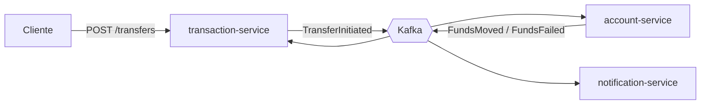

# Payments Platform Microservices

Plataforma de pagos y transferencias entre cuentas, solo backend, construida con microservicios en **Spring Boot**, **Kafka** y **PostgreSQL**. Aplica el patrón **Outbox**, **idempotencia** en las transferencias y comunicación orientada a eventos.

> **Estado:** en desarrollo. `account-service` y `transaction-service` están funcionando, y el flujo completo de una transferencia se está construyendo por pasos (ver [Roadmap](#roadmap)).

---

## Arquitectura



Una transferencia se crea en estado `PENDING`. `transaction-service` guarda la transferencia, su historial y el evento en **una sola transacción** (Outbox), y un publicador programado envía el evento a Kafka. `account-service` reacciona al evento, mueve los fondos y publica el resultado, y `transaction-service` cierra la transferencia como `COMPLETED` o `FAILED`.

### Servicios

| Servicio | Responsabilidad | Puerto | Base de datos | Estado |
|---|---|---|---|---|
| `account-service` | Clientes, cuentas, saldos y movimientos | 8081 | `accounts_db` (5433) | Implementado |
| `transaction-service` | Crea transferencias, historial de estados y publicación de eventos (Outbox) | 8082 | `transactions_db` (5434) | Implementado (falta cerrar el flujo, Paso 4) |
| `notification-service` | Notificaciones en tiempo real (WebFlux, SSE) | — | `notifications_db` (5435) | Planificado |
| `fraud-service` | Reglas simples de fraude | — | `fraud_db` (5436) | Planificado |
| `api-gateway` | Entrada única, JWT, rate limiting | — | — | Planificado |

---

## Stack

- **Java 21** y **Spring Boot 4**
- **PostgreSQL 16**, con una base de datos por servicio, y **Flyway** para las migraciones
- **Apache Kafka** con **Kafka UI**
- **Docker Compose** para la infraestructura local
- **JUnit 5**, **Mockito** y **MockMvc** para las pruebas

---

## Cómo ejecutarlo

### Requisitos

- JDK 21
- Docker y Docker Compose

### 1. Configurar la contraseña de las bases de datos

La contraseña no está en el repositorio. Copia la plantilla y ponle tu valor:

```bash
cp .env.example .env        # en Windows (CMD): copy .env.example .env
```

Edita `.env` y reemplaza `change_me` por la contraseña que quieras:

```
DB_PASSWORD=tu_contraseña
```

### 2. Levantar la infraestructura

```bash
docker compose up -d
```

Levanta las cuatro bases de PostgreSQL, Kafka (con Zookeeper) y Kafka UI.

### 3. Arrancar los servicios

Cada servicio lee la contraseña de la variable de entorno `DB_PASSWORD`, que debe tener **el mismo valor** que pusiste en `.env`.

**Desde una terminal** (en la carpeta de cada servicio):

```powershell
# PowerShell
$env:DB_PASSWORD="tu_contraseña"
.\mvnw.cmd spring-boot:run
```

```bash
# Linux / macOS
DB_PASSWORD=tu_contraseña ./mvnw spring-boot:run
```

**Desde IntelliJ:** en *Run → Edit Configurations* de cada servicio, agrega `DB_PASSWORD=tu_contraseña` en *Environment variables*.

### Puertos

| Componente | URL / puerto |
|---|---|
| `account-service` | http://localhost:8081 |
| `transaction-service` | http://localhost:8082 |
| Kafka UI | http://localhost:8085 |
| Kafka (desde el host) | `localhost:9092` |
| PostgreSQL | 5433 (accounts), 5434 (transactions), 5435 (notifications), 5436 (fraud) |

---

## API

### account-service

| Método | Endpoint | Descripción |
|---|---|---|
| `POST` | `/api/v1/customers` | Crea un cliente |
| `GET` | `/api/v1/customers/{id}` | Consulta un cliente |
| `POST` | `/api/v1/accounts` | Abre una cuenta para un cliente (`PEN` o `USD`) |
| `GET` | `/api/v1/accounts/{accountNumber}` | Consulta una cuenta y su saldo |
| `POST` | `/api/v1/accounts/{accountNumber}/deposit` | Deposita dinero y registra el movimiento |
| `GET` | `/api/v1/accounts/{accountNumber}/movements` | Historial de movimientos, paginado |

### transaction-service

| Método | Endpoint | Descripción |
|---|---|---|
| `POST` | `/api/v1/transfers` | Crea una transferencia. Requiere el header `Idempotency-Key` |
| `GET` | `/api/v1/transfers/{id}` | Consulta una transferencia |
| `GET` | `/api/v1/transfers/history/{id}` | Historial de estados de una transferencia |

### Ejemplo: crear una transferencia

```
POST http://localhost:8082/api/v1/transfers
Idempotency-Key: 6f1c2d9e-0b3a-4c55-9a7e-1d2f3a4b5c6d
Content-Type: application/json
```

```json
{
  "sourceAccount": "123456789012",
  "targetAccount": "210987654321",
  "amount": 50.00,
  "currency": "PEN",
  "description": "transfer"
}
```

Respuesta `201` con la transferencia en estado `PENDING`. Si repites la petición con la **misma** `Idempotency-Key`, recibes la misma transferencia y no se crea otra.

Pasados unos segundos, el evento `TransferInitiated` aparece en el topic `transfer.events`, visible en Kafka UI (http://localhost:8085).

---

## Decisiones de diseño

| Tema | Resumen |
|---|---|
| **Outbox** | El evento se guarda en la misma transacción que la transferencia, y un publicador lo envía a Kafka. Si Kafka está caído, el evento espera y no se pierde |
| **Idempotencia** | El cliente envía un `Idempotency-Key` por operación. Una llave repetida no duplica la transferencia |
| **Base de datos por servicio** | Ningún servicio lee las tablas de otro, y se comunican solo por eventos |
| **Dinero** | `BigDecimal` / `NUMERIC(19,4)`, bloqueo optimista y un registro de movimientos que nunca se edita |

El detalle y el motivo de cada decisión están en [`docs/decisiones.md`](docs/decisiones.md).

---

## Documentación

| Documento | Contenido |
|---|---|
| [`docs/eventos.md`](docs/eventos.md) | Catálogo de eventos: topics, formato del mensaje y payloads |
| [`docs/decisiones.md`](docs/decisiones.md) | Decisiones técnicas, con su motivo y su costo |
| [`docs/plataforma-pagos-guia.md`](docs/plataforma-pagos-guia.md) | Ruta de construcción paso a paso |

---

## Pruebas

En la carpeta de cada servicio:

```bash
./mvnw clean verify          # en Windows: .\mvnw.cmd clean verify
```

---

## Roadmap

- [x] **Paso 1:** `account-service` (clientes, cuentas, depósitos y movimientos)
- [x] **Paso 2:** infraestructura local (PostgreSQL, Kafka y Kafka UI con Docker Compose)
- [x] **Paso 3:** `transaction-service` con Outbox y publicación de `TransferInitiated`
- [ ] **Paso 4:** `account-service` consume `TransferInitiated`, mueve los fondos y publica `FundsMoved` / `FundsFailed`
- [ ] **Paso 5:** idempotencia en los consumidores (`processed_message`)
- [ ] **Paso 6:** `notification-service` reactivo (SSE)
- [ ] **Paso 7:** `fraud-service`
- [ ] **Paso 8:** API Gateway, Eureka y seguridad (JWT con Keycloak)
- [ ] **Paso 9:** Testcontainers, CI con GitHub Actions y observabilidad
- [ ] **Opcional:** despliegue en Azure y migración de servicios a Quarkus

---

## Autor

[@erickmaycolhc](https://github.com/erickmaycolhc)
